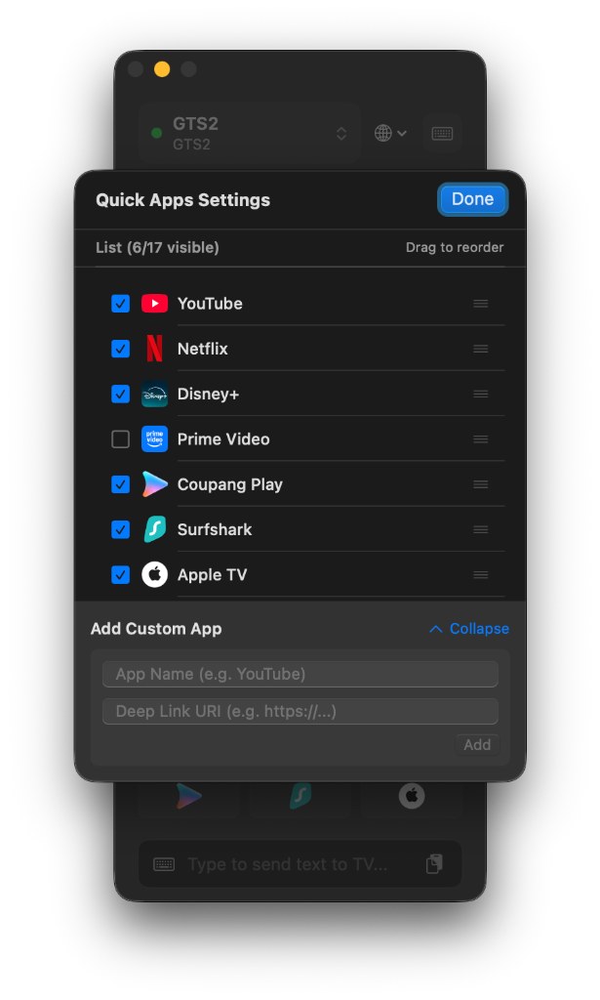

# GTV Remote

<p align="center">
  
</p>

<p align="center">
  <strong>Eine moderne, native macOS-Fernbedienung & Schnell-App-Starter für Google TV / Android TV.</strong><br>
  <em>Bidirektionale TLS-Steuerung mit geringer Latenz, automatische mDNS-Erkennung, sofortige Texteingabe, App-Schnellstart und Tastaturkurzbefehle direkt vom Mac aus.</em>
</p>

<p align="center">
  <a href="https://github.com/badugisoft/gtv-remote/releases/latest"></a>
  <a href="https://github.com/badugisoft/gtv-remote/releases"></a>
  <a href="https://badugisoft.github.io/gtv-remote/"></a>
  
  
  
  
  
</p>

<p align="center">
  <a href="../README.md">English</a> ·
  <a href="README.ko.md">한국어</a> ·
  <a href="README.zh-Hans.md">简体中文</a> ·
  <a href="README.ja.md">日本語</a> ·
  <strong>Deutsch</strong> ·
  <a href="README.fr.md">Français</a> ·
  <a href="README.es.md">Español</a>
</p>

<p align="center">
  <a href="https://badugisoft.github.io/gtv-remote/"><strong>🌐 Projekt-Website</strong></a> ·
  <a href="https://github.com/badugisoft/gtv-remote/releases/latest"><strong>⬇️ Neueste Version laden</strong></a> ·
  <a href="#screenshots">Screenshots</a> ·
  <a href="#funktionen">Funktionen</a> ·
  <a href="#tastaturkurzbefehle">Tastenkürzel</a> ·
  <a href="#installation">Installation</a> ·
  <a href="#faq--fehlerbehebung">FAQ</a> ·
  <a href="#mitwirken--sicherheit">Mitwirken</a>
</p>

---

> [!NOTE]
> **🤖 100 % mit Google Antigravity entwickelt**
>
> Diese gesamte Anwendung – einschließlich TLS-Socket-Kommunikation, Protobuf-Paketserialisierung, automatischer mDNS-Erkennung, SwiftUI-Oberflächen, Überwachung von Tastaturereignissen, Sortierung der Schnell-Apps per Drag-and-Drop, Lokalisierung in 7 Sprachen und Build-Automatisierung – wurde **zu 100 % im autonomen Pair-Programming mit Google Antigravity entworfen, implementiert und verifiziert**.

---

## Screenshots

<p align="center">
  
  
  
  <br>
  <em>GTV Remote: Native macOS Milchglas-UI, Schnell-Apps-Verwaltung & Tastaturkurzbefehle</em>
</p>

---

## Funktionen

- **Natives macOS-Erlebnis**:
  - Zu 100 % mit Swift, SwiftUI und AppKit entwickelt, inklusive nativem `.sidebar`-Milchglaseffekt (`NSVisualEffectView`).
  - Elegantes, um 45 Grad geneigtes Fernbedienungssymbol in der macOS-Menüleiste für direkten Zugriff oder Fokuswechsel.
  - Das Fenster bleibt beim Schließen im Hintergrund aktiv; ein erneutes Öffnen über das Dock oder die Menüleiste erfolgt sofort ohne Prozessneustart.

- **Konfigurationsfreie Netzwerkerkennung & sofortige Wiederverbindung**:
  - Automatische Bonjour-/mDNS-Erkennung aller Google-TV- und Android-TV-Geräte im lokalen Netzwerk (`_androidtvremote2._tcp`).
  - Echtzeit-Tracking und automatische Synchronisierung von IP-Änderungen bei erneuter DHCP-Zuweisung.
  - Begrenzte Wiederverbindungsversuche verhindern Endlosschleifen im Verbindungsstatus.
  - Korrekte Auflösung von Unicode- und internationalen Gerätenamen.
  - Merkt sich automatisch das zuletzt verbundene TV-Gerät und stellt die Verbindung beim Start sofort wieder her.

- **Schnelle, sichere TLS-Verbindung & lokaler Datenschutz**:
  - Sichere gegenseitige Zwei-Wege-TLS-Verschlüsselung nach dem Android-TV-Remote-v2-Protokoll.
  - Integrierte temporäre RSA-2048-Clientzertifikat-Generierung direkt über Apples `Security.framework` (kein externes `openssl`-Programm erforderlich).
  - **100 % lokal & keine Telemetrie**: Sämtlicher Netzwerkverkehr bleibt im lokalen WLAN/LAN ohne Analyse oder externe Server. Details siehe [SECURITY.md](../SECURITY.md).

- **Vollständige Tastaturnavigation & visuelles Feedback**:
  - Navigieren Sie mühelos mit Pfeiltasten, `Enter`, `Esc`, `Home`, `Leertaste` und Lautstärketasten durch TV-Menüs.
  - Echtzeit-**Tastendruck-Animation (0,15 s)**, die betätigte Schaltflächen auf dem Bildschirm hervorhebt.

- **Intelligente Texteingabe & Zwischenablage-Sync**:
  - Mit der integrierten Eingabeleiste senden Sie Suchbegriffe, URLs und Passwörter direkt an Ihren Fernseher.
  - Per Klick oder `Cmd + V` übertragen Sie Text aus der Mac-Zwischenablage direkt in das Eingabefeld des TVs.

- **Anpassbarer Schnell-App-Starter**:
  - Vorinstallierte Presets für beliebte Streaming-Dienste: **YouTube, Netflix, Disney+, Apple TV, Prime Video, Coupang Play, Max, Paramount+, YouTube TV, Tubi, Pluto TV, Google Play Store, Surfshark, Plex, Spotify, Twitch, Stremio**.
  - Einheitliche App-Verwaltung mit **Drag-and-Drop-Sortierung** und Sichtbarkeits-Kontrollkästchen.
  - Unterstützung zum Hinzufügen, Bearbeiten und Entfernen benutzerdefinierter Deep-Links (`https://` oder `app://`).
  - Festes 3-Spalten-Raster für einheitliche Schaltflächengrößen.
  - Direkte Zifferntasten (`1` bis `9`) zum sofortigen Starten Ihrer wichtigsten Schnell-Apps.

- **Mehrsprachige Lokalisierung (7 Sprachen)**:
  - Unterstützt **English**, **한국어 (Koreanisch)**, **简体中文 (Chinesisch vereinfacht)**, **日本語 (Japanisch)**, **Deutsch**, **Français (Französisch)** und **Español (Spanisch)**.
  - Übernimmt beim ersten Start automatisch die eingestellte macOS-Systemsprache.
  - Über die Globus-Schaltfläche in der Kopfzeile lässt sich die UI-Sprache jederzeit sofort wechseln.

---

## Tastaturkurzbefehle

Wenn das Fernbedienungsfenster aktiv ist, stehen folgende Kurzbefehle zur Verfügung:

| Taste | Fernbedienungsfunktion | Beschreibung |
| :--- | :--- | :--- |
| **Pfeiltasten (↑ ↓ ← →)** | `DPAD_UP / DOWN / LEFT / RIGHT` | D-Pad Navigation |
| **Return / Eingabetaste** | `DPAD_CENTER` | Auswählen / OK |
| **Esc / Backspace** | `BACK` | Zurück / Menü schließen |
| **H** | `HOME` | Zur TV-Startseite |
| **Leertaste** | `MEDIA_PLAY_PAUSE` | Wiedergabe / Pause umschalten |
| **+ / =** | `VOLUME_UP` | Lauter |
| **- / _** | `VOLUME_DOWN` | Leiser |
| **M** | `VOLUME_MUTE` | Stummschaltung umschalten |
| **P** | `POWER` | Ein- / Ausschalten |
| **A** | `ASSISTANT` | Google Assistant aufrufen |
| **I** | `INPUT` | Eingangsquelle wechseln |
| **1 ~ 9** | Schnell-App 1–9 | Schnell-App 1 bis 9 direkt starten |
| **Cmd + V** | Zwischenablage-Sync | Text aus Mac-Zwischenablage an TV senden |
| **Cmd + W** | Fenster ausblenden | Fenster verbergen (läuft im Hintergrund weiter) |

---

## Installation

### Option 1: Vorgefertigtes Release herunterladen (Empfohlen)

1. Laden Sie die neueste `GTV-Remote-v*.dmg` oder `GTV-Remote-v*.zip` unter [GitHub Releases](https://github.com/badugisoft/gtv-remote/releases/latest) herunter.
2. Öffnen Sie die `.dmg`-Datei (oder entpacken Sie die `.zip`-Datei) und ziehen Sie **GTV Remote.app** in Ihren Ordner `/Applications` (**Programme**).
3. Starten Sie **GTV Remote** aus `/Applications`.

> **Signiert & Notarisiert:** Offizielle Releases (`v1.0.5+`) sind mit einem Apple Developer ID-Zertifikat signiert und von Apple notarisiert, sodass sie ohne Gatekeeper-Warnung gestartet werden können.

---

### Option 2: Aus dem Quellcode erstellen (über Makefile)

#### Voraussetzungen
- macOS 14.0 (Sonoma) oder neuer
- Xcode 16+ oder Swift 6.0+ Command Line Tools

#### Erstellen und Installieren

Klonen Sie das Repository und führen Sie folgende Befehle aus:

```bash
# Release-Binary erstellen, in /Applications/GTV Remote.app installieren und starten
make install

# Release als .app, .dmg und .zip in dist/ verpacken
make package
```

Build-Artefakte bereinigen:
```bash
make clean
```

Deinstallieren:
```bash
make uninstall
```

---

## FAQ & Fehlerbehebung

<details>
<summary><strong>Ist GTV Remote von Apple signiert und notarisiert?</strong></summary>

Ja. Offizielle Releases ab `v1.0.5` sind mit einer Apple Developer ID signiert und von Apple notarisiert, sodass keine Gatekeeper-Warnung erscheint. Falls Sie eine ältere Version (`v1.0.4` oder früher) verwenden, aktualisieren Sie bitte auf das neueste Release.

</details>

<details>
<summary><strong>Mein Google TV / Android TV erscheint nicht in der Geräteliste</strong></summary>

1. Stellen Sie sicher, dass Mac und TV im selben WLAN-Subnetz sind.
2. Prüfen Sie unter **Systemeinstellungen → Datenschutz & Sicherheit → Lokales Netzwerk**, ob **GTV Remote** erlaubt ist.
3. Aktivieren Sie auf dem TV den **Android TV Remote Service** und starten Sie einen neuen Scan in der App.

</details>

<details>
<summary><strong>Wie funktionieren benutzerdefinierte Deep Links in Quick Apps?</strong></summary>

Öffnen Sie die **Schnell-Apps-Einstellungen**, um Apps per Drag-and-Drop neu anzuordnen oder eigene Apps mit `https://`- oder `app://`-URIs hinzuzufügen. Die ersten 9 sichtbaren Apps lassen sich direkt mit den Tasten `1`–`9` starten.

</details>

<details>
<summary><strong>Sammelt GTV Remote Daten oder verbindet sich mit externen Servern?</strong></summary>

Nein. Die gesamte Kommunikation findet ausschließlich im lokalen Netzwerk per gegenseitigem TLS und lokal erzeugtem RSA-2048-Zertifikat statt. Siehe [SECURITY.md](../SECURITY.md).

</details>

<details>
<summary><strong>Welche TV-Geräte und macOS-Versionen werden unterstützt?</strong></summary>

Alle Geräte mit Google TV / Android TV Remote v2 (Chromecast mit Google TV, Sony Bravia, TCL, Hisense, Nvidia Shield usw.) sowie Macs mit **macOS 14.0 (Sonoma)** oder neuer (Apple Silicon & Intel).

</details>

---

## Projektstruktur

```
gtv-remote/
├── .github/
│   ├── ISSUE_TEMPLATE/               # Fehlerbericht-, Feature- & Konfigurationsvorlagen
│   ├── PULL_REQUEST_TEMPLATE.md      # Pull-Request-Checkliste
│   └── workflows/
│       ├── pages.yml                 # Automatisierter GitHub-Pages-Workflow
│       └── release.yml               # Automatisierter CI/CD-Release-Workflow
├── AGENTS.md                         # Richtlinien für KI-Agenten und Entwickler
├── CONTRIBUTING.md                   # Beitrags- & Build-Anleitung
├── LICENSE                           # MIT-Lizenz
├── Makefile                          # Build-, Paketierungs- und Installationsskript
├── Package.swift                     # Swift-Package-Manager-Manifest
├── README.md                         # Englische Hauptdokumentation
├── SECURITY.md                       # Datenschutzarchitektur & Sicherheitsmeldungen
├── Resources/
│   ├── AppIcon.icns                  # macOS-App-Symbol
│   └── Info.plist                    # Bundle-Konfiguration und Berechtigungen
├── Sources/
│   └── GTVRemote/
│       ├── App/                      # App-Einstiegspunkt & Tastaturüberwachung
│       │   ├── GTVRemote.swift
│       │   └── KeyboardMonitor.swift
│       ├── Core/
│       │   ├── Network/              # mDNS-Erkennung & NIO-TLS-Socket-Bridge
│       │   │   ├── BonjourResolver.swift
│       │   │   ├── DeviceDiscoveryService.swift
│       │   │   ├── TLSSocketBridge.swift
│       │   │   └── TVConnectionManager.swift
│       │   ├── Proto/                # Protobuf-Protokollbindungen
│       │   │   ├── pairing.pb.swift
│       │   │   └── remote.pb.swift
│       │   └── Security/             # RSA-2048-Zertifikatsgenerierung
│       │       └── CertificateManager.swift
│       ├── Localization/             # Lokalisierungs-Engine für 7 Sprachen
│       │   ├── Languages/            # Sprachspezifische String-Implementierungen
│       │   ├── L10n.swift
│       │   ├── LocalizableStrings.swift # Protokoll für Lokalisierungsschlüssel
│       │   └── LocalizationManager.swift
│       ├── Models/                   # Datenmodelle & App-Verknüpfungskatalog
│       │   ├── AppShortcut.swift
│       │   ├── Models.swift
│       │   └── RemoteKey.swift
│       ├── ViewModels/               # Observable Fernbedienungs-Logik
│       │   └── RemoteViewModel.swift
│       └── Views/                    # SwiftUI-Oberflächen & Sheets
│           ├── Components/
│           │   ├── DPadView.swift
│           │   ├── RemoteButtonStyles.swift
│           │   └── SmartInputBar.swift
│           ├── Sheets/
│           │   ├── AppShortcutsSettingsView.swift
│           │   ├── PairingSheetView.swift
│           │   └── ShortcutsView.swift
│           └── RemoteControlView.swift
├── assets/                           # Screenshots und Medien für die Dokumentation
│   ├── app_icon.png
│   ├── keyboard_shortcuts.png
│   ├── quick_apps_settings.png
│   └── remote_main.png
├── docs/                             # Mehrsprachige Dokumentation
│   ├── README.de.md                  # Deutsch
│   ├── README.es.md                  # Español
│   ├── README.fr.md                  # Français
│   ├── README.ja.md                  # 日本語
│   ├── README.ko.md                  # 한국어
│   └── README.zh-Hans.md             # 简体中文
└── site/                             # GitHub-Pages-Website
    ├── index.html
    ├── styles.css
    └── i18n.js
```

---

## Mitwirken & Sicherheit

- Beiträge sind willkommen! Hinweise zu lokalem Build, 7-Sprachen-Lokalisierung und Pull Requests finden Sie in [CONTRIBUTING.md](../CONTRIBUTING.md).
- Informationen zur lokalen Datenschutzarchitektur und zum Melden von Sicherheitslücken finden Sie in [SECURITY.md](../SECURITY.md).

---

## Open-Source-Lizenz

Dieses Projekt steht unter der **MIT-Lizenz**. Weitere Details finden Sie in der Datei [LICENSE](../LICENSE).
