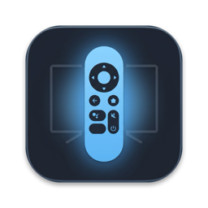

# GTV Remote

<p align="center">
  
</p>

<p align="center">
  <strong>Une télécommande macOS native et moderne avec lanceur d'apps rapides pour Google TV / Android TV.</strong><br>
  <em>Contrôle TLS bidirectionnel à faible latence, découverte automatique mDNS, saisie de texte instantanée, lanceurs d'apps rapides et raccourcis clavier directement depuis votre Mac.</em>
</p>

<p align="center">
  
  
  
  
  
</p>

<p align="center">
  <a href="../README.md">English</a> ·
  <a href="README.ko.md">한국어</a> ·
  <a href="README.zh-Hans.md">简体中文</a> ·
  <a href="README.ja.md">日本語</a> ·
  <a href="README.de.md">Deutsch</a> ·
  <strong>Français</strong> ·
  <a href="README.es.md">Español</a>
</p>

---

> [!NOTE]
> **🤖 100 % conçu avec Google Antigravity**
>
> L'intégralité de cette application — incluant la communication par socket TLS, la sérialisation Protobuf, la découverte automatique mDNS, les vues SwiftUI, la surveillance des touches du clavier, la réorganisation par glisser-déposer des apps rapides, la localisation en 7 langues et l'automatisation du build — a été **100 % conçue, implémentée et vérifiée en programmation en binôme autonome avec Google Antigravity**.

---

## Captures d'écran

<p align="center">
  
  
  
  <br>
  <em>GTV Remote : Interface native macOS en verre dépoli, gestionnaire d'apps rapides et raccourcis clavier</em>
</p>

---

## Fonctionnalités

- **Expérience macOS native** :
  - Développée à 100 % en Swift, SwiftUI et AppKit avec le matériau natif en verre dépoli `.sidebar` (`NSVisualEffectView`).
  - Icône de télécommande inclinée à 45 degrés dans la barre des menus macOS pour un accès ou un basculement en un clic.
  - La fenêtre reste résidente en arrière-plan une fois fermée ; sa réouverture via le Dock ou la barre des menus est instantanée sans redémarrer le processus.

- **Découverte réseau zéro-configuration et reconnexion instantanée** :
  - Découverte automatique Bonjour / mDNS de tous les appareils Google TV et Android TV sur votre réseau local (`_androidtvremote2._tcp`).
  - Suivi en temps réel des changements d'adresse IP et synchronisation automatique lors d'une réattribution DHCP.
  - Limite de sécurité sur les tentatives de reconnexion évitant les boucles infinies.
  - Résolution des noms d'appareils Unicode et internationaux.
  - Mémorise automatiquement le dernier téléviseur connecté et rétablit instantanément la connexion au lancement.

- **Connexion TLS rapide et sécurisée** :
  - Chiffrement TLS mutuel bidirectionnel conforme au protocole Android TV Remote v2.
  - Génération intégrée de certificats clients RSA-2048 temporaires via le framework `Security` d'Apple (aucun binaire `openssl` externe requis).

- **Navigation complète au clavier et retour visuel** :
  - Naviguez dans les menus TV avec les flèches, `Entrée`, `Échap`, `H`, `Espace` et les touches de volume.
  - **Animations de retour de pression en temps réel (0,15 s)** mettant en surbrillance les boutons à l'écran lors d'une frappe clavier.

- **Saisie de texte intelligente et synchronisation du presse-papiers** :
  - Barre de saisie intelligente intégrée pour taper recherches, URL et mots de passe directement sur la TV.
  - Collage en un clic ou via `Cmd + V` pour envoyer le texte de votre presse-papiers Mac vers le champ de saisie de la TV.

- **Lanceur d'apps rapides personnalisable** :
  - Préréglages intégrés pour les plateformes populaires : **YouTube, Netflix, Disney+, Apple TV, Prime Video, Coupang Play, Max, Paramount+, YouTube TV, Tubi, Pluto TV, Google Play Store, Surfshark, Plex, Spotify, Twitch, Stremio**.
  - Gestionnaire unifié avec **réorganisation par glisser-déposer** et cases à cocher de visibilité.
  - Ajout, modification et suppression de liens profonds personnalisés (`https://` ou `app://`).
  - Grille fixe à 3 colonnes conservant des dimensions de boutons homogènes.
  - Raccourcis numériques directs (`1` à `9`) pour lancer instantanément vos apps rapides principales.

- **Localisation multilingue (7 langues)** :
  - Prend en charge **English**, **한국어 (coréen)**, **简体中文 (chinois simplifié)**, **日本語 (japonais)**, **Deutsch (allemand)**, **Français** et **Español (espagnol)**.
  - Respecte automatiquement la langue système de macOS au premier lancement.
  - Bouton globe dédié dans l'en-tête pour changer de langue à tout moment.

---

## Raccourcis clavier

Lorsque la fenêtre de la télécommande est active, les raccourcis suivants sont disponibles :

| Touche | Fonction télécommande | Description |
| :--- | :--- | :--- |
| **Flèches (↑ ↓ ← →)** | `DPAD_UP / DOWN / LEFT / RIGHT` | Navigation directionnelle |
| **Retour / Entrée** | `DPAD_CENTER` | Sélectionner / OK |
| **Échap / Retour arrière** | `BACK` | Retour / Quitter le menu |
| **H** | `HOME` | Aller à l'écran d'accueil TV |
| **Espace** | `MEDIA_PLAY_PAUSE` | Lecture / Pause |
| **+ / =** | `VOLUME_UP` | Augmenter le volume |
| **- / _** | `VOLUME_DOWN` | Baisser le volume |
| **M** | `VOLUME_MUTE` | Couper / Rétablir le son |
| **P** | `POWER` | Allumer / Éteindre |
| **A** | `ASSISTANT` | Lancer l'Assistant Google |
| **I** | `INPUT` | Changer la source d'entrée vidéo |
| **1 ~ 9** | App rapide 1–9 | Lancer directement l'app rapide 1 à 9 |
| **Cmd + V** | Synchro presse-papiers | Envoyer le texte du presse-papiers Mac à la TV |
| **Cmd + W** | Masquer la fenêtre | Masquer la fenêtre (reste active en arrière-plan) |

---

## Installation

### Option 1 : Télécharger une version précompilée (Recommandé)

1. Téléchargez la dernière archive `GTV-Remote-v*.dmg` ou `GTV-Remote-v*.zip` depuis [GitHub Releases](https://github.com/badugisoft/gtv-remote/releases/latest).
2. Ouvrez le `.dmg` (ou décompressez le `.zip`) et glissez **GTV Remote.app** dans votre dossier `/Applications`.
3. Lancez **GTV Remote** depuis `/Applications`.

#### Résoudre l'avertissement macOS de développeur non vérifié / certificat (Gatekeeper)

Comme **GTV Remote** est signé en mode ad-hoc sans certificat payant Apple Developer ID, macOS peut afficher une alerte lors du premier lancement (*« Apple n’a pas pu vérifier que « GTV Remote.app » ne contient pas de logiciel malveillant »* ou *« ne peut pas être ouvert car le développeur ne peut pas être vérifié »*).

**Méthode A — via Réglages Système (interface graphique) :**

1. Essayez d'ouvrir **GTV Remote.app** une première fois, puis cliquez sur **OK** (ou **Annuler**) dans l'alerte.
2. Ouvrez **Réglages Système** → **Confidentialité et sécurité**.
3. Faites défiler jusqu'à la section **Sécurité** et cliquez sur **Ouvrir quand même** en face du message indiquant que `« GTV Remote.app »` a été bloqué.
4. Confirmez en cliquant sur **Ouvrir quand même** (ou **Ouvrir**), puis saisissez votre mot de passe Mac ou utilisez Touch ID.

**Méthode B — via le Terminal :**

```bash
xattr -cr "/Applications/GTV Remote.app"
```

---

### Option 2 : Compiler depuis les sources (via Makefile)

#### Prérequis
- macOS 14.0 (Sonoma) ou ultérieur
- Xcode 16+ ou outils en ligne de commande Swift 6.0+

#### Compilation et installation

Clonez le dépôt et exécutez :

```bash
# Compiler le binaire Release, créer /Applications/GTV Remote.app et lancer
make install

# Générer .app, .dmg et .zip dans dist/
make package
```

Pour nettoyer les fichiers de compilation :
```bash
make clean
```

Pour désinstaller :
```bash
make uninstall
```

---

## Structure du projet

```
gtv-remote/
├── .github/workflows/release.yml     # Workflow CI/CD de publication automatisée
├── AGENTS.md                         # Directives pour agents IA et développeurs
├── Makefile                          # Script d'empaquetage et de déploiement
├── Package.swift                     # Manifeste Swift Package Manager
├── LICENSE                           # Licence MIT
├── README.md                         # Documentation principale (anglais)
├── Resources/
│   ├── AppIcon.icns                  # Icône de l'application macOS
│   └── Info.plist                    # Configuration du bundle et autorisations
├── Sources/
│   └── GTVRemote/
│       ├── App/                      # Point d'entrée & moniteur clavier
│       │   ├── GTVRemote.swift
│       │   └── KeyboardMonitor.swift
│       ├── Core/
│       │   ├── Network/              # Découverte mDNS & pont socket TLS NIO
│       │   │   ├── BonjourResolver.swift
│       │   │   ├── DeviceDiscoveryService.swift
│       │   │   ├── TLSSocketBridge.swift
│       │   │   └── TVConnectionManager.swift
│       │   ├── Proto/                # Bindings Protobuf du protocole
│       │   │   ├── pairing.pb.swift
│       │   │   └── remote.pb.swift
│       │   └── Security/             # Génération de certificat RSA-2048
│       │       └── CertificateManager.swift
│       ├── Localization/             # Moteur de localisation en 7 langues
│       │   ├── Languages/            # Chaînes par langue
│       │   ├── L10n.swift
│       │   ├── LocalizableStrings.swift # Protocole des clés de traduction
│       │   └── LocalizationManager.swift
│       ├── Models/                   # Structures de données & catalogue d'apps
│       │   ├── AppShortcut.swift
│       │   ├── Models.swift
│       │   └── RemoteKey.swift
│       ├── ViewModels/               # Logique métier observable de la télécommande
│       │   └── RemoteViewModel.swift
│       └── Views/                    # Interfaces et feuilles SwiftUI
│           ├── Components/
│           │   ├── DPadView.swift
│           │   ├── RemoteButtonStyles.swift
│           │   └── SmartInputBar.swift
│           ├── Sheets/
│           │   ├── AppShortcutsSettingsView.swift
│           │   ├── PairingSheetView.swift
│           │   └── ShortcutsView.swift
│           └── RemoteControlView.swift
├── assets/                           # Captures d'écran et médias
│   ├── app_icon.png
│   ├── keyboard_shortcuts.png
│   ├── quick_apps_settings.png
│   └── remote_main.png
└── docs/                             # Documentation traduite
    ├── README.de.md                  # Deutsch
    ├── README.es.md                  # Español
    ├── README.fr.md                  # Français
    ├── README.ja.md                  # 日本語
    ├── README.ko.md                  # 한국어
    └── README.zh-Hans.md             # 简体中文
```

---

## Licence Open Source

Ce projet est distribué sous **licence MIT**. Consultez le fichier [LICENSE](../LICENSE) pour plus de détails.
