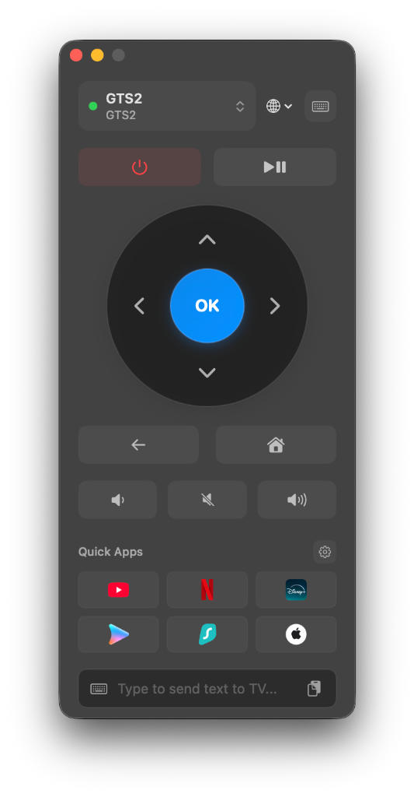

# GTV Remote

<p align="center">
  
</p>

<p align="center">
  <strong>Google TV / Android TV를 위한 모던 네이티브 macOS 리모컨 & 빠른 앱 런처</strong><br>
  <em>저지연 양방향 TLS 제어, mDNS 자동 검색, 즉각적인 텍스트 입력, 빠른 앱 실행, 키보드 단축키를 Mac에서 바로 사용하세요.</em>
</p>

<p align="center">
  <a href="https://github.com/badugisoft/gtv-remote/releases/latest"></a>
  <a href="https://github.com/badugisoft/gtv-remote/releases"></a>
  <a href="https://badugisoft.github.io/gtv-remote/"></a>
  
  
  
  
  
</p>

<p align="center">
  <a href="../README.md">English</a> ·
  <strong>한국어</strong> ·
  <a href="README.zh-Hans.md">简体中文</a> ·
  <a href="README.ja.md">日本語</a> ·
  <a href="README.de.md">Deutsch</a> ·
  <a href="README.fr.md">Français</a> ·
  <a href="README.es.md">Español</a>
</p>

<p align="center">
  <a href="https://badugisoft.github.io/gtv-remote/"><strong>🌐 프로젝트 웹사이트</strong></a> ·
  <a href="https://github.com/badugisoft/gtv-remote/releases/latest"><strong>⬇️ 최신 릴리즈 다운로드</strong></a> ·
  <a href="#스크린샷">스크린샷</a> ·
  <a href="#주요-기능">주요 기능</a> ·
  <a href="#키보드-단축키-안내">단축키</a> ·
  <a href="#설치-방법">설치 방법</a> ·
  <a href="#자주-묻는-질문-faq">FAQ</a> ·
  <a href="#기여-및-보안">기여 및 보안</a>
</p>

---

> [!NOTE]
> **🤖 100% Google Antigravity로 제작됨**
>
> TLS 소켓 통신, Protobuf 패킷 직렬화, mDNS 자동 검색, SwiftUI 뷰, 키보드 이벤트 모니터링, 드래그 앤 드롭 빠른 앱 순서 변경, 7개 언어 다국어 지원, 빌드 자동화까지 이 애플리케이션 전체는 **Google Antigravity와 자율적인 페어 프로그래밍을 통해 100% 설계, 구현 및 검증**되었습니다.

---

## 스크린샷

<p align="center">
  
  
  
  <br>
  <em>GTV Remote: 네이티브 macOS 반투명 글래스 UI, 빠른 앱 설정 및 키보드 단축키 안내</em>
</p>

---

## 주요 기능

- **네이티브 macOS 경험**:
  - 100% Swift, SwiftUI, AppKit과 네이티브 `.sidebar` 반투명 글래스 머티리얼(`NSVisualEffectView`)로 제작되었습니다.
  - macOS 메뉴 막대(상태 막대)에 45도 기울어진 전용 리모컨 아이콘을 배치해 클릭 한 번으로 창을 열거나 전환할 수 있습니다.
  - 창을 닫아도 백그라운드에 상주하므로 Dock이나 메뉴 막대에서 다시 열 때 프로세스 재시작 없이 즉시 실행됩니다.

- **무설정 네트워크 검색 및 즉시 재연결**:
  - 별도 설정 없이 Bonjour / mDNS(`_androidtvremote2._tcp`)로 로컬 네트워크의 모든 Google TV 및 Android TV 기기를 자동 검색합니다.
  - DHCP로 TV의 IP 주소가 변경되더라도 실시간으로 추적해 자동 동기화합니다.
  - 재연결 재시도 횟수 제한을 두어 연결 중 상태가 무한 반복되는 현상을 방지합니다.
  - 유니코드 및 다국어 기기 이름도 올바르게 표시합니다.
  - 마지막으로 연결한 TV를 자동으로 기억해 앱 실행 시 즉시 다시 연결합니다.

- **빠르고 안전한 TLS 연결 및 로컬 프라이버시**:
  - Android TV Remote v2 프로토콜 기반의 양방향 상호 TLS 암호화 통신을 제공합니다.
  - 외부 `openssl` 바이너리 없이 Apple `Security.framework`를 직접 사용해 일회성 RSA-2048 클라이언트 인증서를 내장 생성합니다.
  - **100% 로컬 통신 & 제로 텔레메트리**: 모든 기기 검색과 제어 트래픽은 로컬 Wi-Fi/LAN 내부에서만 처리되며 외부 서버 전송이나 분석 데이터 수집이 없습니다. 자세한 내용은 [SECURITY.md](../SECURITY.md)를 참고하세요.

- **완전한 키보드 내비게이션 및 시각적 피드백**:
  - 방향키, `Enter`, `Esc`, `Home`, `Space`, 볼륨 조절 키로 TV 메뉴를 손쉽게 탐색할 수 있습니다.
  - 키보드로 조작할 때 화면상의 버튼이 **0.15초 동안 강조되는 실시간 피드백 애니메이션**을 제공합니다.

- **스마트 텍스트 입력 및 클립보드 동기화**:
  - 통합 스마트 입력 바를 통해 검색어, URL, 비밀번호를 TV로 바로 입력할 수 있습니다.
  - 클릭 한 번 또는 `Cmd + V`로 Mac 클립보드의 텍스트를 TV 입력란에 즉시 전송합니다.

- **사용자 지정 가능한 빠른 앱 실행기**:
  - 인기 스트리밍 앱 프리셋 기본 내장: **YouTube, Netflix, Disney+, Apple TV, Prime Video, Coupang Play, Max, Paramount+, YouTube TV, Tubi, Pluto TV, Google Play Store, Surfshark, Plex, Spotify, Twitch, Stremio**.
  - **드래그 앤 드롭 순서 조정** 및 표시 여부 체크박스를 제공하는 통합 앱 관리 화면.
  - 사용자 정의 딥링크(`https://` 또는 `app://`) 추가, 수정, 삭제 지원.
  - 일관된 버튼 크기를 유지하는 3열 고정 그리드.
  - 숫자 키(`1` ~ `9`)를 눌러 상위 빠른 앱을 즉시 실행할 수 있습니다.

- **7개 언어 다국어 지원**:
  - **English**, **한국어**, **简体中文**, **日本語**, **Deutsch**, **Français**, **Español**을 지원합니다.
  - 첫 실행 시 macOS 시스템 언어 설정을 자동으로 감지합니다.
  - 상단 헤더의 지구본 버튼을 통해 언제든지 UI 언어를 즉시 전환할 수 있습니다.

---

## 키보드 단축키 안내

리모컨 창이 활성화된 상태에서 아래 물리 키보드 단축키를 사용할 수 있습니다:

| 키 | 리모컨 기능 | 설명 |
| :--- | :--- | :--- |
| **방향키 (↑ ↓ ← →)** | `DPAD_UP / DOWN / LEFT / RIGHT` | D-Pad 상/하/좌/우 이동 |
| **Return / Enter** | `DPAD_CENTER` | 중앙 선택 (OK) |
| **Esc / Backspace** | `BACK` | 뒤로가기 / 메뉴 나가기 |
| **H** | `HOME` | TV 홈 화면으로 이동 |
| **Space** | `MEDIA_PLAY_PAUSE` | 재생 / 일시정지 전환 |
| **+ / =** | `VOLUME_UP` | 볼륨 올리기 |
| **- / _** | `VOLUME_DOWN` | 볼륨 내리기 |
| **M** | `VOLUME_MUTE` | 음소거 켜기 / 끄기 |
| **P** | `POWER` | 전원 켜기 / 끄기 |
| **A** | `ASSISTANT` | 구글 어시스턴트 호출 |
| **I** | `INPUT` | 외부입력 소스 변경 |
| **1 ~ 9** | 빠른 앱 1–9 | 빠른 앱 1~9번 바로 실행 |
| **Cmd + V** | 클립보드 동기화 | 현재 Mac 클립보드 텍스트를 TV로 전송 |
| **Cmd + W** | 창 숨기기 | 리모컨 창 숨기기 (백그라운드 유지) |

---

## 설치 방법

### 방법 1: 빌드된 릴리즈 다운로드 (권장)

1. [GitHub Releases](https://github.com/badugisoft/gtv-remote/releases/latest)에서 최신 `GTV-Remote-v*.dmg` 또는 `GTV-Remote-v*.zip` 파일을 다운로드합니다.
2. `.dmg` 파일을 열거나 `.zip` 압축을 푼 뒤 **GTV Remote.app**을 `/Applications`(응용 프로그램) 폴더로 드래그하여 복사합니다.
3. `/Applications` 폴더에서 **GTV Remote**를 실행합니다.

> **서명 및 공증 완료:** 공식 릴리즈(`v1.0.5+`)는 Apple Developer ID 인증서로 서명 및 Apple 공증(Notarization)을 거쳐 배포되므로 macOS Gatekeeper 경고 없이 바로 실행됩니다.

---

### 방법 2: 소스 코드에서 직접 빌드 (Makefile 사용)

#### 사전 요구 사항
- macOS 14.0 (Sonoma) 이상
- Xcode 16+ 또는 Swift 6.0+ Command Line Tools

#### 빌드 및 설치

저장소를 클론한 후 다음 명령을 실행하세요:

```bash
# Release 바이너리를 빌드하고 /Applications/GTV Remote.app에 패키징 후 실행
make install

# dist/ 폴더에 .app, .dmg, .zip 배포 패키지 생성
make package
```

빌드 산출물 정리:
```bash
make clean
```

앱 제거:
```bash
make uninstall
```

---

## 자주 묻는 질문 (FAQ)

<details>
<summary><strong>GTV Remote는 Apple 서명 및 공증을 받았나요?</strong></summary>

네. `v1.0.5` 이상 공식 릴리즈는 Apple Developer ID 인증서로 서명되고 Apple 공증(Notarization)을 완료하여 Gatekeeper 경고 없이 실행됩니다. 이전 버전(`v1.0.4` 이하)을 사용 중이라면 최신 버전으로 업데이트해 주세요.

</details>

<details>
<summary><strong>기기 목록에 Google TV / Android TV가 나타나지 않습니다</strong></summary>

1. Mac과 TV가 동일한 Wi-Fi 네트워크 / 서브넷에 연결되어 있는지 확인하세요.
2. **시스템 설정 → 개인정보 보호 및 보안 → 로컬 네트워크**에서 **GTV Remote** 권한이 허용되어 있는지 확인하세요.
3. TV에서 **Android TV Remote Service**가 켜져 있는지 확인한 뒤 앱 상단의 **기기 다시 검색**을 누르세요.

</details>

<details>
<summary><strong>빠른 앱 사용자 정의 딥링크는 어떻게 사용하나요?</strong></summary>

**빠른 앱 설정**에서 드래그 앤 드롭으로 순서를 바꾸거나 표시 여부를 선택하고, `https://` 또는 `app://` 딥링크 URI로 사용자 앱을 추가할 수 있습니다. 표시 목록의 상위 9개 앱은 키보드 `1`~`9` 키로 바로 실행됩니다.

</details>

<details>
<summary><strong>분석 데이터나 사용 정보를 외부 서버로 전송하나요?</strong></summary>

아니요. 모든 통신은 로컬 네트워크 내에서 Mac과 TV 간 상호 TLS 및 로컬 생성 RSA-2048 인증서로만 처리됩니다. 자세한 내용은 [SECURITY.md](../SECURITY.md)를 참고하세요.

</details>

<details>
<summary><strong>지원되는 TV 기기와 macOS 버전은 무엇인가요?</strong></summary>

Google TV / Android TV Remote v2를 지원하는 모든 TV·스트리밍 기기(Chromecast with Google TV, Sony Bravia, TCL, Hisense, Nvidia Shield 등)와 **macOS 14.0 (Sonoma)** 이상이 설치된 Apple Silicon 및 Intel Mac을 지원합니다.

</details>

---

## 프로젝트 구조

```
gtv-remote/
├── .github/
│   ├── ISSUE_TEMPLATE/               # 버그 리포트, 기능 요청 및 설정
│   ├── PULL_REQUEST_TEMPLATE.md      # PR 체크리스트 템플릿
│   └── workflows/
│       ├── pages.yml                 # GitHub Pages 자동 배포 워크플로
│       └── release.yml               # CI/CD 자동 릴리즈 워크플로
├── AGENTS.md                         # AI 에이전트 및 개발자 가이드라인
├── CONTRIBUTING.md                   # 기여 및 빌드 가이드
├── LICENSE                           # MIT 라이선스
├── Makefile                          # 릴리즈 패키징 및 배포 스크립트
├── Package.swift                     # Swift Package Manager 매니페스트
├── README.md                         # 영문 프로젝트 문서 (기본)
├── SECURITY.md                       # 프라이버시 아키텍처 및 보안 제보 안내
├── Resources/
│   ├── AppIcon.icns                  # macOS 앱 번들 아이콘
│   └── Info.plist                    # 번들 구성 및 권한 설정
├── Sources/
│   └── GTVRemote/
│       ├── App/                      # 앱 진입점 및 키보드 이벤트 모니터
│       │   ├── GTVRemote.swift
│       │   └── KeyboardMonitor.swift
│       ├── Core/
│       │   ├── Network/              # mDNS 검색 및 NIO TLS 소켓 브리지
│       │   │   ├── BonjourResolver.swift
│       │   │   ├── DeviceDiscoveryService.swift
│       │   │   ├── TLSSocketBridge.swift
│       │   │   └── TVConnectionManager.swift
│       │   ├── Proto/                # Protobuf 프로토콜 바인딩
│       │   │   ├── pairing.pb.swift
│       │   │   └── remote.pb.swift
│       │   └── Security/             # RSA-2048 인증서 생성
│       │       └── CertificateManager.swift
│       ├── Localization/             # 7개 언어 다국어 엔진
│       │   ├── Languages/            # 언어별 문자열 구현
│       │   ├── L10n.swift
│       │   ├── LocalizableStrings.swift # 다국어 키 정의 프로토콜
│       │   └── LocalizationManager.swift
│       ├── Models/                   # 데이터 모델 및 앱 바로가기 카탈로그
│       │   ├── AppShortcut.swift
│       │   ├── Models.swift
│       │   └── RemoteKey.swift
│       ├── ViewModels/               # Observable 리모컨 비즈니스 로직
│       │   └── RemoteViewModel.swift
│       └── Views/                    # SwiftUI 인터페이스 및 시트
│           ├── Components/
│           │   ├── DPadView.swift
│           │   ├── RemoteButtonStyles.swift
│           │   └── SmartInputBar.swift
│           ├── Sheets/
│           │   ├── AppShortcutsSettingsView.swift
│           │   ├── PairingSheetView.swift
│           │   └── ShortcutsView.swift
│           └── RemoteControlView.swift
├── assets/                           # 스크린샷 및 문서 미디어
│   ├── app_icon.png
│   ├── keyboard_shortcuts.png
│   ├── quick_apps_settings.png
│   └── remote_main.png
├── docs/                             # 다국어 문서
│   ├── README.de.md                  # Deutsch
│   ├── README.es.md                  # Español
│   ├── README.fr.md                  # Français
│   ├── README.ja.md                  # 日本語
│   ├── README.ko.md                  # 한국어
│   └── README.zh-Hans.md             # 简体中文
└── site/                             # GitHub Pages 홍보 웹사이트
    ├── index.html
    ├── styles.css
    └── i18n.js
```

---

## 기여 및 보안

- 기여를 환영합니다! 로컬 빌드 방법, 7개 언어 다국어 규칙, PR 절차는 [CONTRIBUTING.md](../CONTRIBUTING.md)를 확인하세요.
- 로컬 전용 프라이버시 구조 및 보안 취약점 제보 방법은 [SECURITY.md](../SECURITY.md)를 참고하세요.

---

## 오픈소스 라이선스

이 프로젝트는 **MIT 라이선스**에 따라 배포됩니다. 자세한 내용은 [LICENSE](../LICENSE) 파일을 참고하세요.
