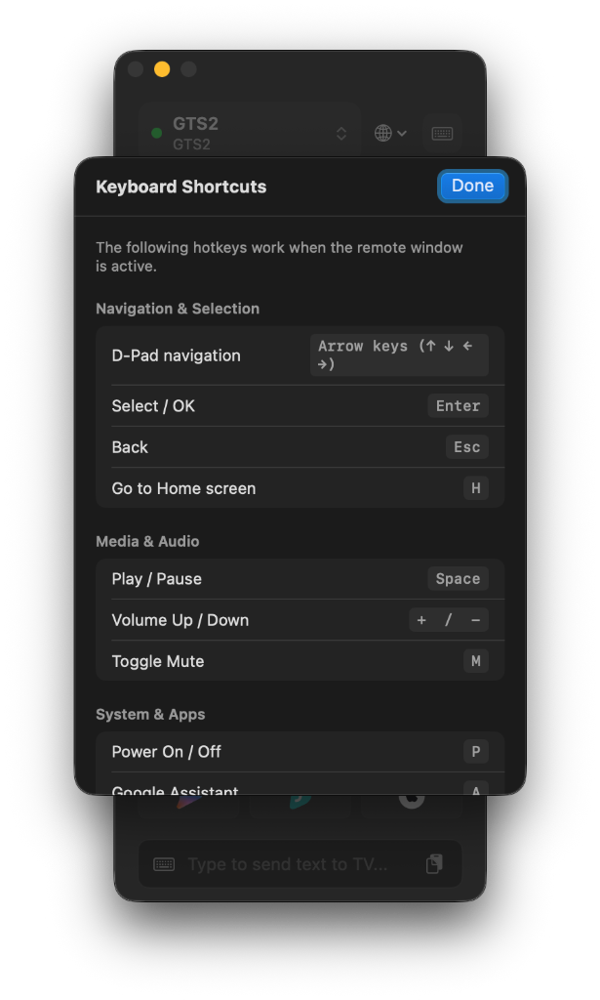

# GTV Remote

<p align="center">
  
</p>

<p align="center">
  <strong>一款现代化的原生 macOS Google TV / Android TV 遥控器与快捷应用启动器。</strong><br>
  <em>在 Mac 上直接体验低延迟双向 TLS 控制、mDNS 自动发现、即时文本输入、快捷应用启动及键盘快捷键。</em>
</p>

<p align="center">
  <a href="https://github.com/badugisoft/gtv-remote/releases/latest"></a>
  <a href="https://github.com/badugisoft/gtv-remote/releases"></a>
  <a href="https://badugisoft.github.io/gtv-remote/"></a>
  
  
  
  
  
</p>

<p align="center">
  <a href="../README.md">English</a> ·
  <a href="README.ko.md">한국어</a> ·
  <strong>简体中文</strong> ·
  <a href="README.ja.md">日本語</a> ·
  <a href="README.de.md">Deutsch</a> ·
  <a href="README.fr.md">Français</a> ·
  <a href="README.es.md">Español</a>
</p>

<p align="center">
  <a href="https://badugisoft.github.io/gtv-remote/"><strong>🌐 项目主页</strong></a> ·
  <a href="https://github.com/badugisoft/gtv-remote/releases/latest"><strong>⬇️ 下载最新版本</strong></a> ·
  <a href="#屏幕截图">屏幕截图</a> ·
  <a href="#功能特性">功能特性</a> ·
  <a href="#键盘快捷键参考">快捷键</a> ·
  <a href="#安装指南">安装指南</a> ·
  <a href="#常见问题">常见问题</a> ·
  <a href="#贡献与安全">贡献与安全</a>
</p>

---

> [!NOTE]
> **🤖 100% 由 Google Antigravity 构建**
>
> 本应用的全部内容——包括 TLS 套接字通信、Protobuf 数据包序列化、mDNS 自动发现、SwiftUI 界面、键盘事件监听、拖拽排序快捷应用、7 种语言本地化以及构建自动化——均**通过与 Google Antigravity 自主结对编程 100% 设计、实现并验证**。

---

## 屏幕截图

<p align="center">
  
  
  
  <br>
  <em>GTV Remote：原生 macOS 毛玻璃界面、快捷应用管理与键盘快捷键指南</em>
</p>

---

## 功能特性

- **原生 macOS 体验**：
  - 100% 采用 Swift、SwiftUI 与 AppKit 开发，结合原生 `.sidebar` 毛玻璃材质（`NSVisualEffectView`）。
  - macOS 菜单栏配备精致的 45 度倾斜遥控器图标，一键打开或切换窗口焦点。
  - 关闭窗口后应用仍常驻后台，通过程序坞（Dock）或菜单栏即可瞬间唤起，无需重启进程。

- **零配置网络发现与即时重连**：
  - 通过 Bonjour / mDNS 自动发现局域网内的所有 Google TV 与 Android TV 设备（`_androidtvremote2._tcp`）。
  - 当电视通过 DHCP 重新分配 IP 地址时，实时跟踪并自动同步最新地址。
  - 内置重连次数安全限制，防止无限处于“连接中”状态循环。
  - 完美解析 Unicode 与多语言设备名称。
  - 自动记住上次连接的电视，启动应用后即刻恢复连接。

- **快速安全的 TLS 连接与本地隐私**：
  - 基于 Android TV Remote v2 协议实现双向互信 TLS 加密。
  - 直接调用 Apple `Security.framework` 在本地生成临时 RSA-2048 客户端证书（无需外部 `openssl` 二进制文件）。
  - **100% 本地通信与零遥测**：所有设备发现与控制流量均仅在本地 Wi-Fi/LAN 内进行，无任何分析或外部服务器连接。详情请参阅 [SECURITY.md](../SECURITY.md)。

- **完整键盘导航与视觉反馈**：
  - 使用方向键、`Enter`、`Esc`、`Home`、`Space` 和音量键轻松控制电视菜单。
  - 按下键盘快捷键时，界面对应按钮提供 **0.15 秒实时按压高亮反馈动画**。

- **智能文本输入与剪贴板同步**：
  - 集成智能输入栏，可直接向电视输入搜索关键词、网址和密码。
  - 一键粘贴或使用 `Cmd + V`，即可将 Mac 剪贴板中的文本直接发送至电视输入框。

- **可定制的快捷应用启动器**：
  - 内置主流流媒体应用预设：**YouTube、Netflix、Disney+、Apple TV、Prime Video、Coupang Play、Max、Paramount+、YouTube TV、Tubi、Pluto TV、Google Play Store、Surfshark、Plex、Spotify、Twitch、Stremio**。
  - 统一的应用管理界面，支持**拖拽调整顺序**与显示复选框勾选。
  - 支持添加、编辑和删除自定义深度链接（`https://` 或 `app://`）。
  - 固定 3 列网格布局，确保按钮尺寸整齐一致。
  - 支持数字键（`1` 至 `9`）直接启动前 9 个快捷应用。

- **7 种语言本地化支持**：
  - 支持 **English**、**한국어（韩语）**、**简体中文**、**日本語（日语）**、**Deutsch（德语）**、**Français（法语）** 与 **Español（西班牙语）**。
  - 首次启动时自动匹配您的 macOS 系统语言设置。
  - 顶栏地球图标按钮可随时一键切换界面语言。

---

## 键盘快捷键参考

当遥控器窗口处于激活状态时，可使用以下实体键盘快捷键：

| 按键 | 遥控功能 | 说明 |
| :--- | :--- | :--- |
| **方向键 (↑ ↓ ← →)** | `DPAD_UP / DOWN / LEFT / RIGHT` | 方向键导航 |
| **Return / Enter** | `DPAD_CENTER` | 确认选择 (OK) |
| **Esc / Backspace** | `BACK` | 返回 / 退出菜单 |
| **H** | `HOME` | 回到电视主屏幕 |
| **Space** | `MEDIA_PLAY_PAUSE` | 播放 / 暂停切换 |
| **+ / =** | `VOLUME_UP` | 音量增加 |
| **- / _** | `VOLUME_DOWN` | 音量减小 |
| **M** | `VOLUME_MUTE` | 静音切换 |
| **P** | `POWER` | 电源开关 |
| **A** | `ASSISTANT` | 调出 Google 助理 |
| **I** | `INPUT` | 切换视频输入源 |
| **1 ~ 9** | 快捷应用 1–9 | 直接启动快捷应用 1 至 9 |
| **Cmd + V** | 剪贴板同步 | 将 Mac 剪贴板文本发送至电视 |
| **Cmd + W** | 隐藏窗口 | 隐藏遥控器窗口（在后台保持运行） |

---

## 安装指南

### 方式一：下载预编译发行版（推荐）

1. 前往 [GitHub Releases](https://github.com/badugisoft/gtv-remote/releases/latest) 下载最新的 `GTV-Remote-v*.dmg` 或 `GTV-Remote-v*.zip`。
2. 打开 `.dmg` 文件（或解压 `.zip` 压缩包），将 **GTV Remote.app** 拖入 `/Applications`（应用程序）文件夹。
3. 从 `/Applications` 中启动 **GTV Remote**。

#### 解决 macOS“未验证开发者”/ 证书警告（Gatekeeper）

由于 **GTV Remote** 使用 ad-hoc 方式签名且未购买付费 Apple Developer ID 证书，首次打开时 macOS 可能会显示安全提示（例如 *“Apple 无法验证‘GTV Remote.app’是否包含恶意软件”* 或 *“无法打开，因为无法验证开发者”*）。

**方法 A — 通过“系统设置”允许运行（图形界面）：**

1. 先尝试打开一次 **GTV Remote.app**，在弹出的提示框中点击 **完成**（或 **取消**）。
2. 打开 **系统设置** → **隐私与安全性**。
3. 向下滚动至 **安全性** 部分，在提示已阻止使用 `“GTV Remote.app”` 的信息旁点击 **仍要打开**。
4. 在确认对话框中点击 **仍要打开**（或 **打开**），并输入 Mac 密码或使用触控 ID 验证。

**方法 B — 通过终端移除隔离属性：**

```bash
xattr -cr "/Applications/GTV Remote.app"
```

---

### 方式二：从源码构建（通过 Makefile）

#### 环境要求
- macOS 14.0 (Sonoma) 或更高版本
- Xcode 16+ 或 Swift 6.0+ 命令行工具

#### 构建与安装

克隆仓库并执行以下命令：

```bash
# 构建 Release 版本，打包安装到 /Applications/GTV Remote.app 并启动
make install

# 在 dist/ 目录中生成 .app、.dmg 和 .zip 发布包
make package
```

清理构建产物：
```bash
make clean
```

卸载应用：
```bash
make uninstall
```

---

## 常见问题

<details>
<summary><strong>macOS 提示“无法验证开发者”或阻止打开应用怎么办？</strong></summary>

预构建版本采用 ad-hoc 签名。请打开**系统设置 → 隐私与安全性**点击**仍要打开**，或在终端执行 `xattr -cr "/Applications/GTV Remote.app"`。

</details>

<details>
<summary><strong>设备列表中未显示我的 Google TV / Android TV</strong></summary>

1. 确认 Mac 与电视连接在同一 Wi-Fi 子网。
2. 前往**系统设置 → 隐私与安全性 → 本地网络**，确认已允许 **GTV Remote** 访问本地网络。
3. 确认电视已开启 **Android TV Remote Service**，然后点击应用顶部的重新扫描按钮。

</details>

<details>
<summary><strong>快捷应用的自定义深层链接如何使用？</strong></summary>

在**快捷应用设置**中可通过拖拽调整顺序、切换显示状态，或使用 `https://` / `app://` URI 添加自定义应用。排名前 9 的可见应用可直接通过键盘 `1`–`9` 启动。

</details>

<details>
<summary><strong>GTV Remote 会收集数据或连接外部服务器吗？</strong></summary>

不会。所有通信均通过双向 TLS 与本地生成的 RSA-2048 证书在局域网内完成。详情请参阅 [SECURITY.md](../SECURITY.md)。

</details>

<details>
<summary><strong>支持哪些电视与 macOS 版本？</strong></summary>

支持所有兼容 Google TV / Android TV Remote v2 的设备（Chromecast with Google TV、Sony、TCL、Hisense、Nvidia Shield 等）以及 **macOS 14.0 (Sonoma)** 及更高版本的 Apple Silicon / Intel Mac。

</details>

---

## 项目结构

```
gtv-remote/
├── .github/
│   ├── ISSUE_TEMPLATE/               # 问题与功能请求模板
│   ├── PULL_REQUEST_TEMPLATE.md      # PR 检查清单模板
│   └── workflows/
│       ├── pages.yml                 # GitHub Pages 自动部署工作流
│       └── release.yml               # CI/CD 自动发布工作流
├── AGENTS.md                         # AI 代理与开发者指南
├── CONTRIBUTING.md                   # 贡献与构建指南
├── LICENSE                           # MIT 许可证
├── Makefile                          # 发布打包与部署脚本
├── Package.swift                     # Swift Package Manager 清单
├── README.md                         # 英文文档（主文档）
├── SECURITY.md                       # 隐私架构与安全报告说明
├── Resources/
│   ├── AppIcon.icns                  # macOS 应用图标
│   └── Info.plist                    # Bundle 配置与权限说明
├── Sources/
│   └── GTVRemote/
│       ├── App/                      # 应用入口与键盘事件监听
│       │   ├── GTVRemote.swift
│       │   └── KeyboardMonitor.swift
│       ├── Core/
│       │   ├── Network/              # mDNS 发现与 NIO TLS 套接字桥接
│       │   │   ├── BonjourResolver.swift
│       │   │   ├── DeviceDiscoveryService.swift
│       │   │   ├── TLSSocketBridge.swift
│       │   │   └── TVConnectionManager.swift
│       │   ├── Proto/                # Protobuf 协议绑定
│       │   │   ├── pairing.pb.swift
│       │   │   └── remote.pb.swift
│       │   └── Security/             # RSA-2048 证书生成
│       │       └── CertificateManager.swift
│       ├── Localization/             # 7 种语言本地化引擎
│       │   ├── Languages/            # 各语言字符串实现
│       │   ├── L10n.swift
│       │   ├── LocalizableStrings.swift # 定义本地化键的协议
│       │   └── LocalizationManager.swift
│       ├── Models/                   # 数据模型与快捷应用目录
│       │   ├── AppShortcut.swift
│       │   ├── Models.swift
│       │   └── RemoteKey.swift
│       ├── ViewModels/               # Observable 遥控器业务逻辑
│       │   └── RemoteViewModel.swift
│       └── Views/                    # SwiftUI 界面与弹窗视图
│           ├── Components/
│           │   ├── DPadView.swift
│           │   ├── RemoteButtonStyles.swift
│           │   └── SmartInputBar.swift
│           ├── Sheets/
│           │   ├── AppShortcutsSettingsView.swift
│           │   ├── PairingSheetView.swift
│           │   └── ShortcutsView.swift
│           └── RemoteControlView.swift
├── assets/                           # 截图与文档媒体资源
│   ├── app_icon.png
│   ├── keyboard_shortcuts.png
│   ├── quick_apps_settings.png
│   └── remote_main.png
├── docs/                             # 多语言文档
│   ├── README.de.md                  # Deutsch
│   ├── README.es.md                  # Español
│   ├── README.fr.md                  # Français
│   ├── README.ja.md                  # 日本語
│   ├── README.ko.md                  # 한국어
│   └── README.zh-Hans.md             # 简体中文
└── site/                             # GitHub Pages 宣传网站
    ├── index.html
    ├── styles.css
    └── i18n.js
```

---

## 贡献与安全

- 欢迎贡献代码！构建指南、7 种语言本地化规范与 PR 流程请参阅 [CONTRIBUTING.md](../CONTRIBUTING.md)。
- 本地隐私架构与安全漏洞报告方式请参阅 [SECURITY.md](../SECURITY.md)。

---

## 开源协议

本项目基于 **MIT 协议** 开源。详情请参阅 [LICENSE](../LICENSE) 文件。
